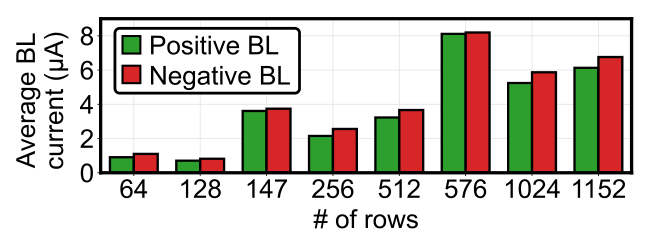
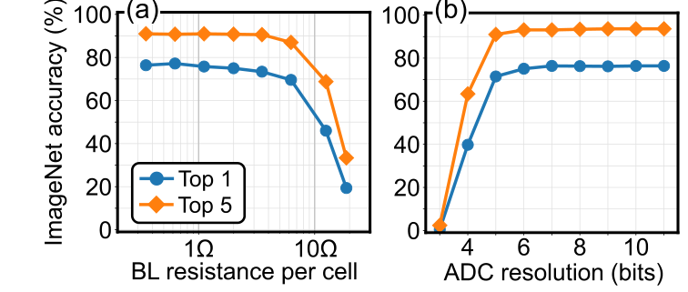
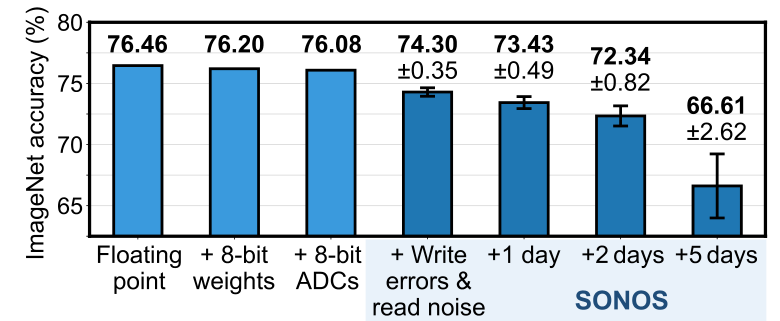

# 用 CrossSim 在 ResNet14 + CIFAR-10 上复现类 Fig.8–10

> 面向这次课程实验的讲解与操作指导书。默认你会运行 Python，但不熟悉 SONOS、模拟存算和 CrossSim 内部实现。这里补的是完成实验所需的知识，不要求先通读论文。所有正式数据必须由真实 CIFAR-10 推理得到；文中的示意算例、原论文数字与本次实测范围会分别标明。
>
> 材料核对日期：2026-11-06。目标论文：T. P. Xiao 等，*An Accurate, Error-Tolerant, and Energy-Efficient Neural Network Inference Engine Based on SONOS Analog Memory*，IEEE TCAS-I 69(4), 1480–1493, 2022，DOI：[10.1109/TCSI.2021.3134313](https://doi.org/10.1109/TCSI.2021.3134313)。代码核对基点：本地 CrossSim `af2d4e64d231f0dc8200446710041305a50c1d0a`，项目版本 3.2.1。本目录的辅助脚本另附于该基点之后。

## 0. 先明确要交什么，以及从哪里开始

课程把论文的 **ResNet50 + ImageNet** 换成 **ResNet14 + CIFAR-10**。要复现的是实验方法及因果关系，不是把准确率、拐点或柱子高度强行调成论文数字。

| 要交的结果 | 横轴 | 纵轴 | 回答的问题 |
|---|---|---|---|
| 类 Fig.8 | 网络实际用到的阵列输入行数 | 正 BL / 负 BL 平均电流，μA | 为什么大量行一起计算，位线总电流仍不高？ |
| 类 Fig.9(a) | 相邻单元间 BL 寄生电阻，Ω，对数坐标 | top-1 / top-5 准确率 | 多大寄生电阻开始影响分类？ |
| 类 Fig.9(b) | ADC 位宽，2–10 bit | top-1 / top-5 准确率 | ADC 精度增加到哪里就收益递减？ |
| 类 Fig.10 | FP → 权重量化 → 输入量化 → ADC → 写入误差 → 读噪声 → 保持时间 | top-1 准确率，均值±标准差 | 每类误差损失多少？长期保持会怎样？ |
| 记录表附加实验 | 仅写入误差、仅读噪声、保持模型单独开启 | 相对同一量化基线的损失 | 谁主导？归因有什么限制？ |
| 协同设计结论 | 一组器件、电路、算法参数 | 与 FP 的精度差 | 能否满足 −1.50 或 −0.50 **个百分点**的预算？ |

课程要求来自：[项目指导书与记录表](../../../src/软硬件协同设计项目-指导书与记录表.docx)、[实验 PPT](../../../src/PPT软硬件协同设计项目实验.pdf)。PPT 第 10 页规定图号映射与提交要求；DOCX 给出了 Nruns≥5、漂移 1–5 天、ADC 2–10 bit、独立归因和协同设计预算等更细要求。PPT 写的截止时间是 11 月 20 日，实际提交安排以老师后续通知为准。

建议按这个顺序做：

1. 读第 1–4 节，知道模型、电流、误差和版本限制。
2. 按第 5–6 节跑通 FP 与无误差 CrossSim，先排除接线错误。
3. 用 100 张图跑通各路径并计时；这阶段不写最终结论。
4. 跑类 Fig.8，再分别跑 ADC、Rp、累积误差；正式配置统一保存。
5. 按第 12–14 节完成统计、归因、联合验证与报告。

## 1. 你实际在仿真什么

### 1.1 从一张 CIFAR-10 图片到一个类别

一张图是 `3×32×32` 的 RGB 张量。ResNet14 给出 10 个类别得分；最大得分对应 top-1 预测。top-5 则检查正确类别是否在得分最高的 5 类中。CIFAR-10 只有 10 类，top-5 很容易接近上限，所以主要看 top-1，但记录表要求的 top-5 也要保留。

ResNet 中卷积是主要计算。一个 `3×3` 卷积、输入通道数为 64 时，每个输出像素都需要一个长度 `3×3×64=576` 的输入向量，与一组权重点积。CrossSim 把这些点积改成模拟阵列运算，其他 ReLU、残差相加、池化等仍由 PyTorch 执行。

因此一次完整图片推理包含很多卷积窗口，每个窗口又包含 MVM。**一张图的一次推理不等于一次 MVM。**

### 1.2 MVM、阵列行数和代码矩阵形状

MVM 是 matrix-vector multiplication，矩阵–向量乘法：

$$
y_j=\sum_{i=1}^{r}w_{ji}x_i.
$$

这里 `r` 是输入向量长度，即物理描述里的输入行数；`j` 对应输出通道、位线输出。一个 `3×3, Cin=64, Cout=64` 卷积可写成：

```text
软件权重：64 × 64 × 3 × 3
展开矩阵：64 × 576       # CrossSim/PyTorch 存储顺序：[输出, 输入]
输入窗口：576 × 1
输出窗口：64 × 1
```

所以在本代码中统计阵列输入行数，读的是 `core_pos.matrix.shape[1]`，不是 `shape[0]`。软件矩阵的“行”与论文物理阵列的“输入行”命名不同，必须看含义。

### 1.3 为什么指定 ResNet14 却会转换 16 个层

上游 `ResNet_cifar10(n)` 遵循 `depth=6*n+2`，因此 **`n=2` 才是 ResNet14**。默认示例的 `n=3` 是 ResNet20。

本实现还含有两条改变通道数的 `1×1` 投影捷径。按网络命名惯例叫 ResNet14，但实际可转换为模拟计算的 Conv/Linear 模块有 **16 个**。输入范围与 ADC 范围文件也各有 16 行；不应删掉两行来凑“14”。

本地权重已包含在：

```text
applications/dnn/torch/cifar10_resnet/models/resnet14_cifar10.pth
```

不需要为了这次实验先重新训练，也不需要为了拿到它下载整个旧版模型子模块。

### 1.4 为什么你的 Fig.8 不会有 1152 行那根柱子

这份 ResNet14 的实际输入维度分组为：

```text
16、27、32、64、144、288、576
```

27 来自首层 `3×3×3`；144/288/576 来自 `3×3×16/32/64`；16/32 来自投影捷径，64 来自最后分类器。以当前 `rows_max=1152`，这些层都不必沿输入维度切分。不要人为填出 1024、1152 行的数据。

这里要分清：**实际激活的输入行数**最多 576；**规定的物理阵列容量/互连距离**仍可为 1152。当前 separate-source 寄生求解器在 `selected_rows='top'` 时，还会计入较小矩阵到读出端之间未选行对应的线阻。因此“实际行数小于 1152”不等于 Rp 仿真中线长一定只按 576 计算。第 9 节会说明这个映射选择。

## 2. 只需理解的器件和电路知识

### 2.1 SONOS 保存的是电导，网络需要的是带符号权重

SONOS 是 silicon–oxide–nitride–oxide–silicon，硅–氧化物–氮化物–氧化物–硅。氮化层俘获的电荷改变晶体管阈值，进而改变读取时的电流。对于本实验，不需要求解完整晶体管模型，只需理解：**写入权重等于把单元设成某个目标电导，读出时电导决定电流。**

电导不能为负，所以用差分对保存正负权重：

$$
w_{ji}\propto G^+_{ji}-G^-_{ji}.
$$

ONE_SIDED 映射将权重幅值放在一侧，另一侧接近关态。正、负位线先各自汇流，外围再相减。

一个示意算例：设 `Gmax=16 μS`，权重归一化后为 `+0.25`，则正侧约 `4 μS`、负侧接近零。在 `0.1 V` 下，该单元打开时正侧约 `0.4 μA`。这只是说明映射与单位的算例，不是测量数据。

### 2.2 为什么“8-bit 权重”不等于每个 SONOS 都有 256 个精确状态

论文用一个符号位加 7 位幅值：差分对表示 8 位带符号权重，每个单元目标幅值为 7 位，即 128 个目标电流水平。器件编程后还存在随机误差，相邻电流水平的分布可以重叠，因此不是理想数字存储器的“128 个绝不混淆的状态”。

本仓库 `dnn_inference_params` 在 BALANCED、单权重切片时，把 `weight_bits=8` 映射为 `cell_bits=7`。不要额外再把 `cell_bits` 改成 8，否则实验定义变了。

### 2.3 输入按位串行，权重不按位切片

8 位输入可以分成低位到高位逐次打开行选择开关。这叫输入位串行，在代码中由 `input_bitslicing=True, input_slice_size=1` 控制。

它与“把一个权重拆到多个阵列存储”不同。后者是权重切片，由 `Nslices` 控制；本实验设 `Nslices=1`。

论文采用 SIR（successive integration and rescaling，逐次积分与缩放）在模拟域累积各输入位的部分结果，**累积完才做一次 ADC**。对应：

```python
input_bits = 8
input_bitslicing = True
input_slice_size = 1
adc_per_ibit = False
```

首层归一化图像含负数，代码用 SignMagnitudeDAC：8 位中有 1 个符号位，实际有 7 个幅值切片。后续 ReLU 后非负输入有 8 个幅值切片。对输入位数的比较必须保留这个约定。

### 2.4 正/负 BL、电流差和 ADC 输入是三个不同量

BL 是 bit line，位线。无寄生、无噪声时，对于某个输入位 `b_i∈{0,1}`：

$$
I_j^+=V_{read}\sum_iG^+_{ji}b_i,\qquad
I_j^-=V_{read}\sum_iG^-_{ji}b_i.
$$

两者都非负。网络点积对应的是两者相减，再结合输入位权、缩放和 ADC。

例如 `I+=8 μA, I−=7 μA`，差分输出只有 `1 μA`，但两根金属线分别承受 8、7 μA。**用差分输出或它的绝对值画 Fig.8，会低估线上的真实电流。**

对于首层带符号输入，论文硬件用互补行对选择 `W` 或 `−W`。辅助脚本用下面的理想等效式重建非负电流：

$$
I^+=I_{max}(\tilde G^+ b^+ +\tilde G^- b^-),\quad
I^-=I_{max}(\tilde G^- b^+ +\tilde G^+ b^-).
$$

其中 `b+ = max(b,0)`、`b−=max(−b,0)`，`G̃=G/Gmax`。首层 CSV 同时保存逻辑输入行数与互补行对的物理行数，不把这个软件等效重建说成晶体管级实测。

### 2.5 三类误差分别在什么时候发生

| 误差 | 一句话解释 | 重采样时机 | 对这次实验的意义 |
|---|---|---|---|
| 编程误差 programming error | 单元写出来的电导偏离目标 | 每次重新建立/编程阵列 | 同一块“芯片”内持续存在，MC 要重新编程 |
| 读噪声 read noise | 读取同一单元时电流会波动 | 每次底层读取/MVM | 不能只在初始化加一次随机扰动 |
| 保持误差 retention/drift | 随时间发生均值偏移与分布变宽 | 按指定保持时间建立状态分布 | `t=5` 是模拟 5 天，不是让程序运行 5 天 |

论文 Fig.4 显示编程与保持分布，Fig.5 给出读噪声。论文的读噪声标准差约为电流的 **0.87%**。保持损失不仅是平均值移动，更重要的是器件间随机变化扩大。

可以用下式理解，但系数必须来自选定器件模型，不能凭空拟合：

$$
I_{stored}(t)=I_{target}+\mu_{drift}(I_{target},t)
 +\sigma_{state}(I_{target},t)z,
\qquad I_{read}=I_{stored}(t)+\sigma_{read}(I_{stored})z'.
$$

`z,z'` 是独立标准正态随机变量。`σstate(·,0)` 包含编程散布；`σstate(·,t)` 是 t 时刻完整散布，不应再机械加一份 t=0 编程误差。

### 2.6 为什么 SONOS 的小权重精度与大阵列有关

网络中小幅值权重多。差分 ONE_SIDED 映射又让许多器件处于接近关态；高 On/Off 比使这些关态器件几乎不漏电。SONOS 低电流处绝对编程误差还趋小，于是常用的小权重受到的绝对扰动较小。

单个输出的扰动近似为：

$$
\Delta y_j=\sum_i x_i\Delta w_{ji},\qquad
\operatorname{Var}(\Delta y_j)\approx\sum_i x_i^2\operatorname{Var}(\Delta w_{ji}).
$$

第二式以误差独立、零均值近似为前提。它说明误差的影响由输入和权重状态分布共同决定，不只是“行数越多误差就乘以行数”。相关误差、系统漂移还会产生交叉项或偏置，不能用独立方差公式解释一切。

低总电流同时减轻 `IR drop`，即金属线电流乘电阻引起的电压损失。这把 Fig.8 与 Fig.9(a) 连起来；再结合 ADC 所需精度，才形成器件—电路—算法联合选择。

## 3. 先把论文三张图读对

### 3.1 原 Fig.8：统计自然出现的阵列尺寸，不是随意改模型做行数扫描



来源：用户提供论文 PDF 第 7 页，印刷页 1486。原文规定：按相同行数的阵列分组，并在 **30 次图片推理中的所有 MVM** 上平均；图示是输入的 **最低有效位 LSB** 的电流。

注意课程 DOCX 写“跨 30 次推理 MVM 平均”，容易误读为只采集 30 个底层矩阵乘。按论文原意应使用 30 张图片推理，包含所有层、所有滑动窗口；本辅助脚本采用此口径，并在结果中写明。

原图已经非单调，例如某个小阵列电流可能比大阵列更高，因为它们对应不同层，权重幅值、激活稀疏度、输入位分布不同。这不是强制单调的器件 I–V 曲线。

### 3.2 原 Fig.9：隔离电路因素



原图 `(a)` 用 500 张 ImageNet 图看 BL 相邻单元电阻；`(b)` 用 1000 张图看 ADC 分辨率。最大行数为 1152，**不包含 SONOS 器件误差与读噪声**。

论文观察到寄生电阻超过约 1 Ω 后精度开始下降；8 位 ADC 已接近饱和区。这些都是特定网络、映射、量程、数据及几何下的结果。迁移到 CIFAR-10 后不得把 1 Ω、8 bit 写成自己测得的拐点。

### 3.3 原 Fig.10：累积误差，最后看保持时间



原图使用全部 50,000 张 ImageNet 测试图，编程误差重新采样 10 次；排除寄生电阻以控制计算量。图中给出的 top-1 数字为：

| 原论文配置 | 原论文 top-1 |
|---|---:|
| FP | 76.46% |
| +8-bit 权重 | 76.20% |
| +8-bit ADC | 76.08% |
| +编程误差与读噪声 | 74.30% ±0.35 |
| +1 天 | 73.43% ±0.49 |
| +2 天 | 72.34% ±0.82 |
| +5 天 | 66.61% ±2.62 |

这里 `76.46−74.30=2.16` 是 **2.16 个百分点（pp）**，不是相对下降 2.16%。原图也没有把编程与读噪声分成两根柱子；课程要求比原图更细，需要拆开并补充 3、4 天。

这些数字仅用于阅读原图，不是 ResNet14 的验收标准。自己的 FP 必须实际测量。

## 4. 开跑前必须知道的版本差异：模型叫 SONOS 不代表参数相同

### 4.1 当前内置模型来自另一份实测数据

当前文件 [SONOS.py](../../simulator/devices/custom/SONOS.py) 的注释引用的是 **Agrawal 等，IEDM 2022**，而本次目标论文是 Xiao 等 **TCAS-I 2022**。该文件里提到的“Fig.10(a)、Fig.11(b)”属于它引用的 IEDM 材料，不是本实验要复现的 TCAS-I Fig.10。

当前代码具有以下可核对的模型事实（电流单位是 nA）：

$$
\sigma_{state}(I,0)=19.88665(1-e^{-I/176.3115}),
$$

$$
\sigma_{read,native}(I)=12.58037(1-e^{-I/215.36557}).
$$

保持模型在 `t=0,1,2,3,4,5` 天分别存有系数；均值偏移为 10 阶多项式，散布为时间相关饱和指数模型。5 天之外涉及外推，本实验不这样做。

特别地，在低电流极限，内置读噪声比例约为 `12.58037/215.36557≈5.84%`，不是目标论文的 `0.87%`。所以不能仅写 `noise_model='SONOS'` 就宣称完全使用了目标论文 Fig.5 的噪声统计。

### 4.2 本指导书与脚本采用的方案

为了能用现有仓库开展课程实验，辅助脚本默认：

- 编程/保持：当前内置 `SONOS` 拟合，明确记录版本来源差异。
- 读噪声：按目标论文描述，用正态比例模型 `σI=0.0087 I`；这对应对论文噪声统计的简化仿真，不重建 1/f 时间相关波形。
- `--noise-model native`：可另跑当前内置 SONOS 读噪声，作为版本敏感性比较，不能与默认结果悄悄混用。

报告应写明“在当前 CrossSim SONOS 编程/保持拟合下，按 TCAS-I 的架构与实验方法进行缩小网络复现；读噪声采用论文描述的比例模型”。不要写成“已经精确复现原器件数据”。

如果老师要求严格使用目标论文器件拟合，下一步应获取作者原始拟合参数，或从该论文 Fig.4 数字化提取均值/标准差后重新拟合、检查单位及误差范围，并注明图像数字化的不确定性。本指导书**没有虚构或自动反推这一组原始拟合系数**。模型来源这件事需要在正式报告中如实说明，必要时向老师确认可接受范围。

### 4.3 t>0 时，不要再叠加两遍编程误差

`simulator/devices/idevice.py::apply_write_error` 明确假设漂移模型包括编程误差：

```text
t=0：调用 programming_error，或在理想编程模型下调用 drift_error(t=0)
t>0：调用 drift_error(t)
```

因此 `retention` 场景不是“先给矩阵加 t=0 写入误差，再对已扰动矩阵额外调用 SONOS.drift_error”。辅助脚本对每个时间点都从原始权重创建全新阵列，交给原有调用链处理。

同样，“关闭 programming_error，只保留 SONOS drift_error”并不等于得到纯粹、独立的漂移噪声，因为 `drift_error` 的完整分布仍有写入散布。课程独立归因表应注明“保持模型单独开启，含其内置状态散布”，或采用第 12 节的增量归因。

## 5. 固定参数：先让同一套实验说同一种话

以下是辅助脚本默认协议。它是为本次课程选定的工作配置，未知出处的预校准文件不被说成论文原始校准结果。

| 参数 | 数值/设置 | 含义 |
|---|---|---|
| 模型 | `ResNet_cifar10(2)` | ResNet14；16 个可转换模块 |
| checkpoint | `resnet14_cifar10.pth` | 已随仓库提供，不重新训练 |
| 测试预处理 | mean=`[0.485,0.456,0.406]`，std=`[0.229,0.224,0.225]` | 跟随该权重的上游推理示例；不要随手换成另一套 CIFAR 统计 |
| BN folding | `from_torch(..., fuse_batchnorm=True)` | 把 BN 系数折进前一卷积/全连接 |
| bias | `digital_bias=True, bias_rows=0` | 偏置留在数字端 |
| 映射 | BALANCED、ONE_SIDED | 差分对，单侧存幅值 |
| 权重/输入/ADC | 8/8/8 bit | 主协议；仅在单变量实验中改变对应项 |
| 权重切片 | `Nslices=1` | 不做权重跨阵列位切片 |
| 输入 | 1-bit 串行；首层有符号 | 其余层 ReLU 后非负 |
| ADC 时机 | `adc_per_ibit=False` | 模拟累积后转换 |
| `Rmin` | 62,500 Ω | `Gmax=16 μS` |
| `Rmax` | `6.25e11 Ω` | 采用 On/Off=`1e7` 的有限比值近似 |
| `Vread` | 0.1 V | `Imax=0.1/62500=1.6 μA` |
| `infinite_on_off_ratio` | False | 保留有限关态电流；不是无穷开关比 |
| 最大输入行数 | 1152 | 作为论文架构参照，实际网络行数更小 |
| 电流来源 | `current_from_input=False` | 选择信号控制开关，电流由独立路径提供，更接近 SONOS 门控读出 |
| 寄生配置 | 主实验只扫 `Rp_col`，`Rp_row=0`，端点电阻=0 | 隔离 BL 相邻单元金属段电阻 |
| 行摆放 | `selected_rows='top'` | 固定距读出端的几何约定，不在扫描中改变 |
| 读噪声默认 | `generic`、`proportional_noise=True`、`alpha_noise=0.0087` | 目标论文的近似比例噪声 |
| MC 种子 | `20261106 + run_index` | 同时设置 Python / NumPy / Torch / CuPy |
| 数据子集种子 | 314159 | 各条件使用相同测试索引，与器件 MC 分开 |

无输入量化的 `ideal/w8` 阶段没有输入位切片，脚本令 `current_from_input=True` 以满足 API；这两个阶段没有寄生，属于数值点积对照，不据此作物理电路结论。

原上游示例默认 `Rmin=1e4, Rmax=1e6`，不是本表。若以 `Vread=0.1` 配合 `Rmin=1e4`，最大电流变成 10 μA，也超出了当前 SONOS 模型有效范围，不能照抄。

BN 折叠会改变映射的权重范围。例如 BN 的通道比例因子会乘到该通道的所有卷积权重上。若电流统计、校准与正式推理对 BN 的处理不同，几组图就不在描述同一个硬件映射。

## 6. 从零开始跑通：先做能发现接线错误的检查

### 6.1 目录和环境

以下命令均在 PowerShell 中执行，当前目录是仓库根目录：

```powershell
cd 'E:\Resources\01_lessons\class3_LS\09-chip-cim\work\sim1\cross-sim'
$env:Path = "$env:USERPROFILE\.local\bin;$env:Path"
uv sync --locked
uv run --locked python verify_environment.py

$tool = 'docs/sim-work/tools/run_experiment.py'
$plot = 'docs/sim-work/tools/plot_results.py'
```

无需激活 `.venv`。这里使用 PyTorch + CuPy，不依赖 TensorFlow GPU。CPU 和 GPU 的 CrossSim 后端初始化后不可在同一进程随意切换；每条命令启动一个独立 Python 进程。

### 6.2 先跑合成输入，只检查路径

```powershell
uv run --locked python $tool --case q8 --gpu --smoke --n 2 --out scratch/sim-work/smoke-q8.json
```

这里 `--smoke` 使用随机张量，不是 CIFAR-10 图片。终端显示 `SMOKE ONLY`，JSON 中 `synthetic=true`；准确率没有实验意义。绘图脚本会拒绝它，不要把这份结果放入报告。

### 6.3 下载 CIFAR-10，测真实 FP 基线

```powershell
uv run --locked python $tool --case fp --gpu --n 1000 --download --out scratch/sim-work/pilot-fp.json
```

数据默认下载到 `scratch/sim-work/data/cifar10/`，位于仓库已有的 Git 忽略目录下，避免误提交数据集。首次需要联网，之后无需重复加 `--download`。这个目录与 PyTorch checkpoint、ADC 范围文件是不同资源。

`fp` 直接运行原始 PyTorch 模型。先检查输出有限、预训练权重成功载入、图片数量正确。别用“未经加载的随机初始化 ResNet14”当基线。

### 6.4 再测无量化、无误差 CrossSim

```powershell
uv run --locked python $tool --case ideal --gpu --n 1000 --out scratch/sim-work/pilot-ideal.json
```

`ideal` 使用相同权重、预处理和图片子集，转换层后关闭权重/输入/ADC 量化及器件、寄生误差。它与 FP 的输出应接近；不要要求浮点实现逐位完全相同。若大量准确率差异，先检查转换、BN、层顺序和预处理，而不是急着解释 SONOS 物理。

本次附带验证还检查了合成输入上 FP 与 ideal 的 logits 接近；正式测试集精度仍须你运行后获得。

## 7. 校准：先把 ADC 的“量程”和“位数”分开

### 7.1 为什么 8 位也可能很不准

ADC 的位宽只决定可用码字数，量程决定这些码字分布在哪里。若范围是 `[−L,L]`，步长近似：

$$
\Delta\approx\frac{2L}{2^B-1}.
$$

示意算例：8 位、范围 `[−1,1]`，步长约 `2/255=0.00784`；若同样的信号错误使用 `[−100,100]`，步长变成约 `0.784`，小输出全部被粗糙处理。反之量程过窄会剪裁大输出。增加位宽不能修复所有剪裁。

论文对每层用 500 张图片收集输出，再寻找使 L1 量化误差最小的量程，优化时采用 12 位；之后扫实际 ADC 位宽。**“校准优化用 12 位”不等于实际硬件需要 12 位 ADC。**

### 7.2 先用仓库范围调通，再做自己的 ADC 校准

仓库已提供 ResNet14 输入量程、ADC 量程。辅助脚本默认使用 `input_limits_ResNet14.npy` 和 `adc_limits_ResNet14_balanced.npy`。它们足以调通，但文件本身没有完整训练/校准元数据，不能断言它们就是目标论文的 12 位校准协议。

正式 ADC/Rp/误差实验前，建议在 CIFAR-10 **训练集**固定 500 张图重新校准 ADC：

```powershell
uv run --locked python $tool --case calibrate --gpu --n 500 --download --out scratch/sim-work/calibration.json
$adc = 'scratch/sim-work/calibration.adc.npy'
```

这会得到 `calibration.json` 与 `calibration.adc.npy`，不覆盖上游文件。输入为 8 位、ADC 暂时关闭，器件与寄生误差关闭；收集的是全部输入位已经累积后的 ADC 前信号；每层用 L1、12 位校准，再保存范围。

校准期间不使用测试标签优化范围。正式测量保持量程文件不变，并记录其 SHA256。脚本会自动保存范围文件哈希。

辅助脚本继续采用仓库输入量程；这是一个清楚可复现的选择，但还不是对输入量程来源的重新复现。若需进一步严格化，可复制并修改上游 `calibrate_inputs.py`：`n=2`、训练集 500 张、关闭输入和 ADC 量化；校准到 8 位输入，首层采用有符号对称范围，再修改辅助脚本加载自己保存的输入范围。原示例手工给首层设 `[-2.64,2.64]`，且会保存到上游路径，务必复制后换输出位置。改完输入范围后应重新校准 ADC。

### 7.3 为什么不直接照抄上游串行模式的 ADC profiling

当前 `BalancedCore` 在输入位切片下，`profile_adc_inputs` 保存的是各个位切片的原始输出；`get_profiled_adc_inputs` 会把它们取出。直接把这些值摊平去校准，会混淆“每个位的瞬时信号”和“最终 SIR 累积信号”。

辅助脚本在 `core.adc.mvm.convert` 的调用点采集输入，这时信号已经完成位权累积、正负相减和相应缩放，直接对应本协议下的 ADC。采集只在 `calibrate` 模式开启，避免正式全测试时一直保存大数组。

输入校准和 ADC 校准都可能占用较多内存。先用 `--n 20` 的校准文件调通，随后以新文件名运行正式 500 张校准；不能把合成输入校准文件用于正式结果。

## 8. 类 Fig.8：真实网络输入下统计两根 BL 的 LSB 电流

### 8.1 固定什么、变化什么

使用默认 8/8/8、1152 最大容量、无器件误差、无寄生；只按实际网络形成的阵列尺寸分组。这里不通过改变 `--rows` 来生成不同横坐标，那是另一种受控阵列切分实验。

### 8.2 执行命令

```powershell
uv run --locked python $tool --case bl --gpu --n 30 --batch-size 1 --adc-limits $adc --out scratch/sim-work/fig8.json
uv run --locked python $plot --kind fig8 --input scratch/sim-work/fig8.json --out scratch/sim-work/fig8
```

输出包括原始 JSON、每个阵列的统计、按行数汇总、PNG 和 CSV。

### 8.3 脚本到底统计了什么

1. 用 `from_torch` 转换完整 ResNet14，BN 折叠、数字偏置。
2. 在每个实际 BalancedCore 上获取它收到的、经过 DAC 量化的向量。
3. 用相同 DAC 的 `convert_sliced` 取 LSB。最低位指幅值最低位，不是符号位。
4. 用实际编程后的 `G+/Gmax`、`G−/Gmax`，按第 2.4 节的式子重建正/负 BL 非负电流。
5. 乘 `Imax=1.6 μA` 换算单位。没有再乘激活校准上限或网络权重缩放系数；这些缩放属于数值输出恢复，不是单元实际电流。
6. 每个阵列先在 BL、窗口、图片内求均值，再对同逻辑行数的阵列等权平均。

JSON 也保存将所有 BL 样本直接合并的 `sample_weighted_*` 值，两种平均可能不同，因为不同层有不同窗口数。主图采用前一种，报告中注明统计口径即可；不要在不同横坐标选择不同加权方法。

### 8.4 怎样解释结果

理论最坏上界为“每行最大电流 × 所有行均打开”。576 行时是 `576×1.6=921.6 μA`，但这要求每个相关器件都处于最大态且输入该位都为 1，真实网络远不满足。

实际电流远低于该上界的原因可以拆成三件事：小权重多；差分对另一侧常处于关态且开关比高；某个位上只有部分输入有效。高位往往比 LSB 更稀疏，这也是原论文只展示 LSB 的原因之一。

如果结果非单调，先按层查看 `per_array`，看对应的权重与激活是否不同。不能仅凭一根柱子“更高”判定模拟器出错。

原图是理想/统计意义上的位线电流。辅助脚本在 Rp=0 下做数学重建，不含导线压降与晶体管非线性；不能把它当作对真实电流传感器的模拟测量。首层互补行对的实物几何也未完全展开为一张双行矩阵，报告其软件等效边界。

## 9. 类 Fig.9(a)：寄生电阻扫描

### 9.1 这个 Rp 是哪一个电阻

是 **相邻两个单元之间的一小段 BL 金属线电阻**，单位 Ω；不是器件电阻，也不是整条位线端到端电阻。器件最小电阻为 62.5 kΩ，两者相差几个数量级。

金属线串接很多段，越靠近读出端承载的累积电流越大，所以不能只算一个孤立的 `1 Ω / 62500 Ω` 就断言完全没有影响。

脚本采用 `Rp_col=扫描值`、`Rp_row=0`、`current_from_input=False`。在本代码的 separate-source 求解器中，MVM 时 `Rp_col` 对应输出求和线，`Rp_row` 是独立供流侧路径的参数；不要只按参数里“row”这个单词想象成选择栅线的电阻。

### 9.2 必须隔离器件误差

保持：权重、输入、ADC 位宽、量程、测试索引、BN、行数上限、行摆放一致。关闭编程误差、读噪声、漂移。脚本 `rp` 场景已经这样设置。

默认 ADC 仍为 8 位，所以该曲线比较的是“同一量化硬件基线增加 Rp 后的变化”，不是与理想 FP 直接比较。

### 9.3 从小样本开始扫描

```powershell
$rpValues = @(0, 0.01, 0.03, 0.1, 0.3, 1, 3, 10, 30, 100)
foreach ($r in $rpValues) {
    uv run --locked python $tool --case rp --gpu --n 100 --batch-size 1 --rp $r --adc-limits $adc --out "scratch/sim-work/pilot-rp-$r.json"
    if ($LASTEXITCODE -ne 0) { throw "Rp=$r 仿真失败，请检查收敛日志" }
}
```

100 张是调试。找到大概转折区后，换 `formal-rp-...` 文件名前缀、至少 500 张相同测试图，再在转折附近加密。若资源允许，以 1000 张或更大子集交叉核实。

```powershell
# 这里要求 formal-rp-*.json 已由真实正式扫描生成
uv run --locked python $plot --kind rp --input 'scratch/sim-work/formal-rp-*.json' --out scratch/sim-work/fig9a
```

绘图把 `Rp=0` 画成横向基准线，正 Rp 使用对数横轴。0 无法放在真正对数轴上，不要偷偷替换为一个很小的正值。

### 9.4 怎么定义“拐点”

视觉拐点主观，建议同时给一个预先声明的操作标准：相对于同样量化设置的 `Rp=0`，首次下降超过 0.5 pp 的采样点，记为 `R_first_fail`；前一个通过点记为 `R_last_pass`。

然后报告一个区间，而不是声称精确到小数点后几位：

```text
本次采样下，0.5 pp 下降阈值位于 (R_last_pass, R_first_fail]。
该区间还受测试子集大小与采样步距限制。
```

0.5 pp 是本指导书建议的判定阈值，不是论文给的定义；可以按老师要求改，但应在看曲线前固定。

### 9.5 为什么 `selected_rows` 也必须记录

本地 `NonInterleaved_SepSource.py` 会在实际矩阵输入行数不足 `rows_max` 时处理剩余线段。`top` 表示有效行离 ADC 较远，可能把未选行对应的输出线阻集中计入末段；`bottom` 则改变供流端的额外路径。

本脚本固定为 top。若想研究“按实际大小裁剪的独立小阵列”，必须明确修改容量/几何并重新做相应校准，作为单独实验，而不能一部分层用短线、一部分层用 1152 行长线却没有说明。软件 signed-input 等效还没有自动构造论文首层互补行对的全部几何，这也是物理数值边界之一。

### 9.6 求解失败不等于准确率为零

较大 Rp 可能导致迭代不收敛。遇到 `Parasitic resistance too high: could not converge`，记录“数值失败/未测得”，不要填 0% 当结果。

先尝试减小 batch、检查方向与参数；需要调整 `Niters_max_parasitics`、`relaxation_gamma`、`Verr_th_mvm` 时，在一两个点验证收敛与结果稳定后再应用到扫描，并把求解设置写入记录。不要只为得到一根平滑曲线而放宽误差阈值。

如果扫描范围内没有转折，就报告该范围与测试分辨率，不编造拐点。

### 9.7 能否据此说 7 nm 工艺一定可行

论文论证的是它的 40 nm 工艺和阵列假设下，单位线阻可低于容忍范围。更先进工艺的线宽、厚度、长度、材料、电阻率、接触电阻和走线层都要重新评估，不能仅按“节点越小越好”。

课程报告可给出约束链：本实验容忍 Rp 区间 → 给定实际金属层几何，用 `R≈ρL/(wt)` 估算单元间段电阻 → 与容忍区间比较 → 留设计裕量。没有 PDK/几何数据时，只能说“得到候选设计约束”，不能宣称完成 40→7 nm 工艺验证。

## 10. 类 Fig.9(b)：ADC 2–10 位扫描

### 10.1 只动 ADC 位宽

关闭器件误差和 Rp，固定 8 位权重、8 位输入、映射与**同一份量程**。主曲线用同一份 12 位优化所得范围，对实际 B=2…10 扫描。不要每个位宽偷偷换一种量程，又把差异全部归因于位数。

```powershell
foreach ($b in 2..10) {
    uv run --locked python $tool --case adc --gpu --n 1000 --bits $b --adc-limits $adc --out "scratch/sim-work/adc-$b.json"
    if ($LASTEXITCODE -ne 0) { throw "ADC=$b 失败" }
}
uv run --locked python $plot --kind adc --input 'scratch/sim-work/adc-*.json' --out scratch/sim-work/fig9b
```

一份有效的图通常包含低位明显受损区、快速恢复区、收益递减区，但不保证与原图在相同位数转折，也不保证每个采样点严格单调。

### 10.2 怎样选择 ADC 位宽并留裕量

先定义可接受相对高位 ADC 的下降，例如 0.2 pp；从高位平台向低位寻找满足条件的最小 B。为了避免在敏感边界上设计，可再加 1 位裕量，并检查是否仍满足总体精度预算。

必须明确你比较的是：

- 高位 ADC 平台（只隔离 ADC 的损失）；还是
- FP 精度（包括权重/输入量化等已有损失）。

这两个约束不同。可以同时报告，但不能混写。0.2 pp 与加 1 位都是设计规则示例，需要由自己的曲线、预算和资源约束支持，不是论文强制值。

CrossSim 给出准确率，不会自动给出“多一位 ADC 增加多少芯片能耗”。本实验最多支持“位数/精度折衷”，要得到能效还需独立电路能量模型。

## 11. 类 Fig.10：累积误差与 1–5 天保持

### 11.1 比课程表再多留一行 ADC，避免归因含混

课程要求区分 8-bit 权重、8-bit 激活。建议采用下列完整阶梯：

| 顺序 | 脚本 case | 权重 | 输入 | ADC | 器件状态 |
|---:|---|---:|---:|---:|---|
| 0 | fp | FP | FP | 无 | 原始 PyTorch |
| 1 | w8 | 8 | FP | 无 | 理想器件 |
| 2 | w8a8 | 8 | 8 | 无 | 理想器件 |
| 3 | q8 | 8 | 8 | 8 | 理想器件，器件实验的公共量化基线 |
| 4 | program | 8 | 8 | 8 | 当前 SONOS t=0 写入散布 |
| 5 | write-read | 8 | 8 | 8 | 写入 + 默认论文比例读噪声 |
| 6–10 | retention，days=1…5 | 8 | 8 | 8 | t 时刻完整保持分布 + 读噪声 |

Rp 在整条阶梯里为 0。`retention` 的每一柱从原始 checkpoint 构建新的 t 状态，不是把 day1 的扰动矩阵继续随机加工到 day2。辅助脚本采样各时刻边际分布，不跟踪同一单元从 1 天到 5 天的随机过程，因此不能据它研究单个器件的时间相关轨迹。

### 11.2 正式运行命令

以下可能耗时很长。先用 `--n 100 --nruns 1` 对代表场景计时，再改为正式设置。脚本不会覆盖已有 JSON，调试和正式结果使用不同文件名。

```powershell
foreach ($c in @('fp','w8','w8a8','q8')) {
    uv run --locked python $tool --case $c --gpu --n 10000 --adc-limits $adc --out "scratch/sim-work/ladder-$c.json"
    if ($LASTEXITCODE -ne 0) { throw "$c 失败" }
}

foreach ($c in @('program','write-read')) {
    uv run --locked python $tool --case $c --gpu --n 10000 --nruns 5 --batch-size 8 --adc-limits $adc --out "scratch/sim-work/ladder-$c.json"
    if ($LASTEXITCODE -ne 0) { throw "$c 失败" }
}

foreach ($d in 1..5) {
    uv run --locked python $tool --case retention --gpu --n 10000 --nruns 5 --days $d --batch-size 8 --adc-limits $adc --out "scratch/sim-work/ladder-day$d.json"
    if ($LASTEXITCODE -ne 0) { throw "day$d 失败" }
}

uv run --locked python $plot --kind ladder --input 'scratch/sim-work/ladder-*.json' --out scratch/sim-work/fig10
```

FP、量化理想阶段通常无 MC 随机性，运行一次即可，不需要人为制造非零误差棒；表中写“确定性，N/A”或注明重复得到相同结果。器件随机阶段采用 Nruns≥5。若资源允许用 10 次，与论文次数更接近。

若正式版只能使用固定子集，也要如实写 N、具体索引及限制，并保证相互比较的条件使用相同索引，不能把 100 图 pilot 写成 CIFAR-10 全测试集结果。

### 11.3 MC 到底重置了什么

每个 run 同时设置四套随机种子，再重新加载同一 checkpoint、转换并编程新阵列。这样写入误差改变，读噪声也有新的随机序列；图片索引保持不变。

不要只对同一个固定错误矩阵重复预测 5 次，就声称获得了“5 次写入 Monte Carlo”。只这样做时，若无读噪声，结果可能完全一样。

脚本每个 run 从头构建，因此无需依赖对旧对象是否正确调用 `reinitialize` 的细节。不要在正式推理每个 batch 后重新编程，那会把持续写入误差变成每批次换芯片。

### 11.4 曲线必须严格下降吗

通常加入更多误差或延长保持时间会降低平均准确率，但有限测试样本、随机采样、原始模型局部误分类与量化都可能使个别点略有回升。不要排序、修改随机种子直到它单调，或取每点“最好一次”。

正确操作是保留原始 run、报均值与标准差、检查回升是否在随机波动内，再用更多图片/运行验证有争议点。

如果单开读噪声损失大于写入误差，也不要直接写“论文错了”。先确认用的是默认 0.87% 还是当前内置的另一份噪声模型，检查量程和小样本影响，再讨论网络差异。

## 12. 独立归因、标准差与精度预算

### 12.1 给每种损失一个不歧义的分母

设 `AFP` 是 FP 准确率，`AQ` 是 q8 准确率，`AP/AR/APR/At` 分别是仅写入、仅读噪声、写入+读、t 天保持+读。所有准确率都按百分数记录。

独立器件损失：

$$
L_P=A_Q-A_P,\qquad L_R=A_Q-A_R.
$$

累积曲线里的读噪声增量是 `AP−APR`，与独立损失 `AQ−AR` 不相同。两个随机效应经过非线性网络传播，独立损失也不必相加等于合并损失。

补跑仅读噪声：

```powershell
uv run --locked python $tool --case read --gpu --n 10000 --nruns 5 --adc-limits $adc --out scratch/sim-work/only-read.json
```

保持带来的**增量损失**可用 `APR−At` 描述，表示当前完整保持模型相对刚写入状态额外造成多少精度损失，不声称把随机编程与漂移的物理机制完全统计解耦。

如果记录表必须有“仅漂移”一行，可复制 `parameters()` 中 retention 分支，关闭读噪声、保留 `drift_model='SONOS'`、设置 `error_model='none'`，然后重新跑；必须在表下注明该 drift 模型仍包含时间相关状态散布。辅助脚本没有把这个情形命名为“纯漂移”，以免误导。

### 12.2 均值±标准差怎么计算

设同一条件跑 m 次，每次准确率为 `a1…am`（单位 %）：

$$
\bar a=\frac1m\sum_k a_k,\qquad
s=\sqrt{\frac{\sum_k(a_k-\bar a)^2}{m-1}}.
$$

脚本使用样本标准差 `ddof=1`。图示 `mean±s`，不是 95% 置信区间，也不是 `s/√m`。单次运行没有可估计的 MC 标准差，JSON 用 null 保存。

同一测试集上重采样器件得到的是硬件随机性；它不等于数据集泛化误差。N=100 时每错一张变化 1 pp；N=1000 时为 0.1 pp；N=10000 时为 0.01 pp。这只是准确率的离散步距，不是“误差只有这个量级”的置信保证。用 100 图判断 0.5 pp 精度预算尤其不可靠。

### 12.3 用预算做设计，而不是只列三张图

课程第一目标：

$$
A_{design}\ge A_{FP}-1.50\ \text{pp}.
$$

先算固定量化方案损失 `AFP−AQ`；剩下的才是器件、ADC 调整和保持时间的余量。示意：若量化已经损失 0.8 pp，则 1.5 pp 总预算只剩 0.7 pp，并非每个误差源都各有 1.5 pp。

建议做法：

1. 从 ADC 曲线选最小合格位数，再预留适当裕量。
2. 从 Rp 曲线得到容忍区间，而不是只写一个视觉拐点。
3. 从时间曲线选刷新上限，例如只允许保持到某个天数。
4. 用这些选择构建一组**联合配置**重新评估；单因素结果不能保证组合仍达标。
5. 对均值接近门槛的方案，报告 MC 波动；可额外用 `mean−s` 作保守工程参考，但不得称为严格概率保证。

辅助脚本把基础配置集中在 `parameters()`，可以复制该脚本到自己的实验版本，新增 `joint` case：把选定的 ADC 位数、Rp、器件模型与保持时间一起设置。先保存完整配置，再运行，保留原始单因素结果。

课程第二目标缩为 `AFP−0.50 pp` 时，先检查光量化是否已经超预算。若超过，优先重新评估量程、输入位数/权重位数与映射；若免重训练参数组合仍达不到，再提出硬件感知训练方案。

QAT（quantization-aware training，量化感知训练）主要让网络适应量化；若还在训练前向中注入编程/读噪声等，需要更广义的硬件感知训练。可以从预训练权重初始化、保持原数据预处理，在前向模拟所选硬件分布，反向使用可微近似/直通估计，并在优化器更新后同步 CrossSim 阵列。当前 torch 接口有相应前向/反向能力，但本指导书没有训练或宣称得到训练后的提升。

## 13. 运行时间、文件与记录协议

### 13.1 先估算，尤其是 Rp 与逐单元读噪声

不能根据普通 PyTorch 的速度估计所有 CrossSim 实验。Rp 需要每输入位迭代解电路；逐单元读噪声会破坏部分矩阵乘优化，可能明显增加内存和时间。

计时办法：固定条件跑 100 张，读取 JSON `seconds`；近似用 `t100×(N/100)×Nruns` 估算，另加初始化、数据加载与校准开销。不同 Rp 点可能需要不同迭代数，不能只测 Rp=0 就预测整个扫描。

作为本机路径检查的量级参考：2 个合成输入的写入+读噪声推理，CPU 约 55 秒、GPU 约 5.4 秒；Rp=0.1 Ω 的 GPU 单合成输入约 28.6 秒。这些不是正式 CIFAR-10 性能基准，不宜直接推算最终耗时，但足以说明寄生扫描应先做小样本、再缩窄范围。

显存不足时优先减小 `--batch-size`；正式比较记录同一个 batch 设置。GPU 加速不保证所有小矩阵和寄生场景更快，可以用新进程去掉 `--gpu` 比较 CPU。不要为提速悄悄把逐单元噪声改成 lumped 模型，除非另做一致性验证并标明近似。

### 13.2 输出目录建议

```text
scratch/sim-work/
├── calibration.json
├── calibration.adc.npy
├── fig8.json / fig8.csv / fig8.png
├── formal-rp-0.json、formal-rp-0.1.json……
├── fig9a.csv / fig9a.png
├── adc-2.json …… adc-10.json
├── fig9b.csv / fig9b.png
├── ladder-fp.json …… ladder-day5.json
├── fig10.csv / fig10.png
└── only-read.json
```

`run_experiment.py` 对已有 JSON 报错，避免不同实验意外覆盖。绘图脚本以相同输出名重新运行会重写图片/CSV，请需要保留旧图时换名。

每个 JSON 保存：场景及参数、测试/校准图索引、checkpoint 哈希、输入/ADC 范围哈希、种子、逐次正确数量与 top-1/top-5、耗时、源代码提交号，以及是否为合成输入。辅助脚本本身的版本也应随提交归档；源提交号不能代替记录未提交的脚本差异。

主比较中不要混用不同 checkpoint、数据预处理、图片索引、MC 次数或读噪声模式。绘图脚本会检查同一张图的数据索引一致，但它不能替你识别所有硬件参数是否设置合理。

## 14. 写报告时怎样把结果变成解释

以下给的是回答结构，不是可以直接当作你自己结果填写的结论。

| 记录表位置 | 建议使用的证据与回答结构 |
|---|---|
| 器件三类误差 | 论文 Fig.4/5 + 本文第 2、4 节；写清状态相关、保持分布变宽、读时重采样与模型来源 |
| 参数清单 | 第 5 节表格 + 实际 JSON；N、Nruns、ADC 范围来源与哈希不可漏 |
| 内容一累积曲线 | 自己的 Fig.10 + 各步 pp 损失；区分独立损失与累积增量 |
| 内容一独立归因 | q8、program、read；保持采用声明过的完整模型或增量，说明不能纯物理解耦 |
| 内容二 A | 自己的 Fig.8；说明 LSB、30 图片、统计加权、实际行数、正负 BL |
| 内容二 B | Fig.9(a) + Rp=0 基准 + 阈值区间 + 求解稳定性；没有拐点如实写 |
| 内容二 C | Fig.9(b) + 固定量程 + 最小满足位数及裕量；不凭空给 ADC 能量 |
| 协同设计 | 明确 FP 预算、单项选参依据、联合验证结果、保持/刷新约束 |
| 小网络可迁移性 | 可迁移的是分析方法和误差机制；不可直接迁移的是准确率、拐点、最优位数、能效数字 |
| 未覆盖要素 | 晶体管非线性细节、ADC 非理想、几何/PDK、面积/能耗、时间相关噪声、训练与刷新成本等 |

针对三张图，可用这样的推理句式组织自己的答案：

**Fig.8：**“在相同映射与 LSB 口径下，测得某些行数组的电流……。它相对于 `r×1.6 μA` 的上界为……，说明该网络的权重与激活分布显著降低同时导通电流。非单调点对应……层，而非行数本身的单变量变化。”

**Fig.9：**“在关闭器件误差后，固定 8/8 位与量程，ADC/Rp 的变化使精度……。按预先定义的阈值，满足约束的区间为……。这对本映射给出了电路设计约束；对另一工艺仍须代入真实线阻。”

**Fig.10：**“相对于本网络 FP 的……%，量化基线损失……pp，编程误差独立损失……pp，读噪声在写入后的增量为……pp。各保持时间以完整状态分布重新采样，均值与样本标准差为……。由……预算可选的刷新时间上限是……。”

能效背景可以引用原论文的架构建模结论，但不能根据你在 RTX GPU 上跑仿真耗时或功耗得出 SONOS 芯片 TOPS/W。这个模拟器运行于 GPU，不代表被模拟的芯片就是 GPU。

课程还要求填写 AI 使用情况：可如实记录环境搭建、材料核对、指导书/脚本辅助等环节，正式数据由哪些命令产生、人工检查了什么。不要把这份说明中尚未运行的内容写为你已完成的实测。

## 15. 常见现象与排查顺序

| 现象 | 先检查什么 |
|---|---|
| 结果是 ResNet20 | 上游默认 `n=3`；应为 `n=2`，辅助脚本已固定 |
| 提示缺少模型 | 是否在正确根目录、checkpoint 是否仍在 models；不要因此先下载整个旧子模块 |
| 提示缺少 CIFAR 数据 | 首次真实运行加 `--download`，或用 `--data-root` 指向已有目录 |
| ideal 相对 FP 损失很大 | 权重加载、预处理、BN、残差连接、可转换层与量程行数 |
| SONOS 最大电流越界 | 用 `Vread/Rmin` 核算；本配置 1600 nA，保持模型要求 t>0 时小于 1800 nA |
| 修改 alpha_error 没效果 | 非 generic 模型通常不使用该幅度参数；SONOS 系数在自定义模型内部 |
| 修改 t_drift 没效果 | 是否启用 drift_model、是否重新创建/编程了核心；不要只改旧对象的外层参数 |
| Fig.8 出现负 BL 电流 | 可能统计了带符号等效数值或差分输出，未重建实际正负物理支路 |
| 行数最多 576 | 对当前网络正常；不是 1152 容量参数没有生效 |
| 图 8/9 不严格单调 | 确认变量与数据一致，再考虑层分布、样本噪声；不手动平滑为单调 |
| ADC 10 位仍很差 | 先查量程剪裁、归一化、其他误差开关；位数并非唯一因素 |
| Rp 很大时异常/NaN | 先按数值失败处理；查看迭代日志和求解设置，不当作准确率 0 |
| CPU 后切 GPU 报 backend 错误 | 重新启动进程/Notebook 内核；初始化前统一 useGPU 和 Torch device |
| 读噪声比论文大很多 | 检查 `--noise-model`；内置 SONOS 并非 TCAS-I 的 0.87% 模型 |
| 漂移行“没有单独 programming 开关”仍有随机误差 | 当前 SONOS 保持分布本身包含状态散布，参见第 4.3 节 |
| GPU 显存耗尽 | batch 先改为 1，关闭不需要的 profiling；不要用缩短 N 冒充正式全测试 |
| 绘图拒绝结果 | 检查 synthetic、图片索引是否一致、是否把 read/校准等 JSON 混入阶梯通配符 |

## 16. 源码定位与复核材料

| 实验概念 | 本地源码/文件 | 应看哪里 |
|---|---|---|
| 网络深度、残差和投影 | [build_resnet_cifar10.py](../../applications/dnn/torch/cifar10_resnet/build_resnet_cifar10.py) | ResNet_cifar10、BasicBlock、分类器 |
| 上游预处理/默认参数 | [inference_cifar10_resnet.py](../../applications/dnn/torch/cifar10_resnet/inference_cifar10_resnet.py) | 默认 n=3、base_params_args、normalize |
| 参数构造 | [dnn_inference_params.py](../../applications/dnn/dnn_inference_params.py) | Rmin/Vread、误差、cell_bits、ADC/DAC |
| BN 与转换 | [torch/convert.py](../../simulator/algorithms/dnn/torch/convert.py) | from_torch、convertible_modules、BN folding |
| SONOS 当前拟合 | [SONOS.py](../../simulator/devices/custom/SONOS.py) | 模型来源、系数、时间单位、电流限制 |
| 编程/保持调用关系 | [idevice.py](../../simulator/devices/idevice.py) | apply_write_error |
| 正负支路、输入位累积、ADC | [balanced_core.py](../../simulator/cores/balanced_core.py) | run_xbar_operation、fast_balanced、profile_adc_inputs |
| 输入位切片和符号位 | [quantizer_dac.py](../../simulator/circuits/dac/quantizer_dac.py) | QuantizerDAC/SignMagnitudeDAC.convert_sliced |
| Ω 归一化与选择行设置 | [xbar_parameters.py](../../simulator/parameters/xbar_parameters.py) | ParasiticParameters、Rp_col_norm=Rp_col/Rmin |
| SONOS 门控供流与未选行线阻 | [NonInterleaved_SepSource.py](../../simulator/circuits/array/NonInterleaved_SepSource.py) | Rp_out、N_unselected、selected_rows |
| ADC 校准目标 | [calibration.py](../../applications/dnn/calibration.py) | calibrate_adc_limits、quantizationError_minMax |
| 本目录的可运行入口 | [run_experiment.py](tools/run_experiment.py) | parameters、attach_bl_collectors、attach_adc_collectors、main |

原始文件：[论文 PDF](../../../src/An_Accurate_Error-Tolerant_and_Energy-Efficient_Neural_Network_Inference_Engine_Based_on_SONOS_Analog_Memory.pdf)、[相关完整第 7 页](assets/paper-page-7.png)、[器件误差第 4 页](assets/paper-page-4.png)。图像从用户提供文件渲染，图号及数据按该正式版本核对。

一手在线来源：[Sandia CrossSim 项目](https://github.com/sandialabs/cross-sim)、[Sandia 项目介绍与论文列表](https://cross-sim.sandia.gov/)、[当前内置 SONOS 模型引用的 IEDM 论文](https://ieeexplore.ieee.org/abstract/document/10019564/)。本书代码结论以本地核对提交为准，在线仓库后续更新可能不同。

本次真正跑过哪些检查、哪些完整实验尚未运行，请看 [VALIDATION.md](VALIDATION.md)。
